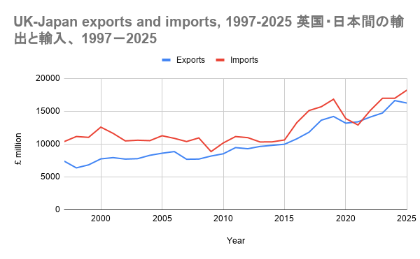

# UK-Japan Trade Analysis (1997-2025)

A spreadsheet analysis of UK trade with Japan, using official ONS data, with a Japanese-language summary. Built in Google Sheets (exported as `.xlsx`)

## The question

How has UK trade with Japan changed since 1997, and how is it split between goods and services?

## The Data

- **Source:** Office for National Statistics (ONS), "UK total trade: all countries, seasonally adjusted" [link](https://cy.ons.gov.uk/economy/nationalaccounts/balanceofpayments/datasets/uktotaltradeallcountriesseasonallyadjusted/octobertodecember2025)
- **Version:** Dated 6 May 2026, downloaded 11 November 2026
- **Coverage:** Annual 1997-2025; quarterly 2016Q1-2025Q4
- **Units:** £ million, rounded (a value of zero means under £500,000)

## What I did

1. Copied the Japan rows (exports, imports, goods, and services) from the ONS file into a raw sheet and left them untouched.
2. Modified them into separate, clean, annual and quarterly tables (`clean`, `clean_quarterly`).
3. Calculated trade balance, total trade, services share of exports, goods and services balances, and year-on-year change (quarterly figures are compared with the same quarter a year earlier).
4. Added check columns ((goods + services) - total), for exports and imports) and confirmed that every row equals zero.
5. Built a pivot table of quarterly exports by year and quarter, and confirmed its yearly totals match the annual table for 2016-2025.
6. Made a lookup sheet of English and Japanese labels, used with VLOOKUP, and created three charts.
7. Wrote notes sheet (in English and Japanese) recording the source, units, checks, and limitations.

## Key Findings

### Exports and imports
- Both rose between 1997 and 2025: exports by about 119% (£7,412m to £16,243m) and imports by about 76% (£10,369m to £18,223m). Exports grew faster, so the gap narrowed from £2,957m to £1,980m.
- Imports exceeded exports in every year except 2021 (exports were £486m higher).
- The gap was largest in 2000 (£4,834m). It was small in 2009 and 2013-2015 (about £530m to £680m) and in 2024 (£353m). It widened again in 2016 and stayed above £2,000m until 2019.
- In 2020, exports fell 7.2% and imports fell 17.5% compared with 2019, narrowing the gap to £700m.

### Goods and services

- Services made up 41% of exports in 1997 and 53.5% in 2025. Services exports grew about 185% and goods exports about 73%.
- Services exports were larger than goods in 1999-2011, 2014-2016, and 2023-2025, and goods were larger in 2012-2013 and 2017-2022.
- The goods balance improved from -£4,927m to -£1,983m, while the services balance fell from +£1,970 to +£3m. By 2025 the deficit is almost entirely in goods.

### Quarterly view

- Quarterly exports ranged from £2,575m (2016Q1) to £4,410m (2024Q3).
- 2019Q1 (£4,202m) was the highest quarter until 2024Q3.
- Exports fell from £3,424m in 2020Q1 to £2,970m in 2020Q2 (-13%) and recovered to £3,339m in 2020Q3, which coincides with the first Covid-19 quarter.
- The quarterly trade balance was positive in only 7 of 40 quarters.

  ## Limitations
  
- Figures are in current prices (not adjusted for inflation), so growth cannot be described as "real".
- The data is seasonally adjusted, so quarter-to-quarter patterns should not be read as seasonal.
- There is no breakdown by commodity, so the analysis does not explain _why_ trade changed.
- ONS figures can be revised.

## Files

| File |  Contents |
|---|---|
| `uk-japan-trade-excel-dashboard.xlsx`  |  Full workbook: raw data, clean tables, pivot table, charts, lookup, and notes  |
|`images/` |  Chart screenshots |

## 日本語の要約

本プロジェクトでは、英国国家統計局（ONS）の季節調整済みデータを用いて、1997‐2025年の英国と日本の貿易（財とサービス）を分析しました。年次データ（1997‐2025年）と四半期データ（2016年第1四半期‐2025年第4四半期）を整理し、ピボットテーブルとグラフで比較しました。

主な結果は次の通りです。

- 英国の対日輸出と輸入はいずれも増加しました（輸出は約119％、輸入は約76％）。輸出の伸びが大きく、差は縮まりました。
- 輸入が輸出を上回った年がほとんどで、例外は2021年のみです。
- 輸出に占めるサービスの割合は、1997年の41％から2025年には53.5％に上昇しました。2025年の赤字は、ほぼ財も取引によるものです。
- 数値は名目値（当年値段）で、物価変動を調整していません。

## 今後の改善点 (What I would do next)

- Add the commodity breakdown (eg. from the UK government's Japan trade and investment factsheet) to see which products drive the changes.
- Extend the analysis with a SQL version of the same questions.
